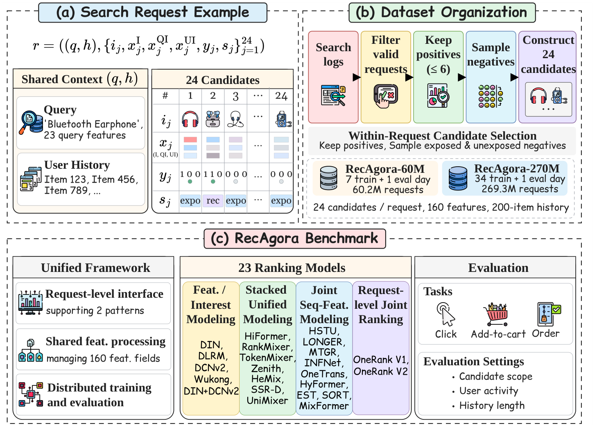
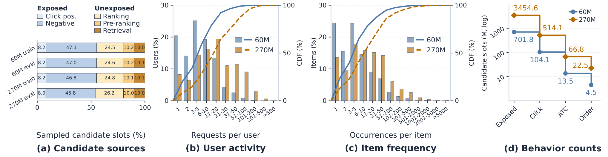
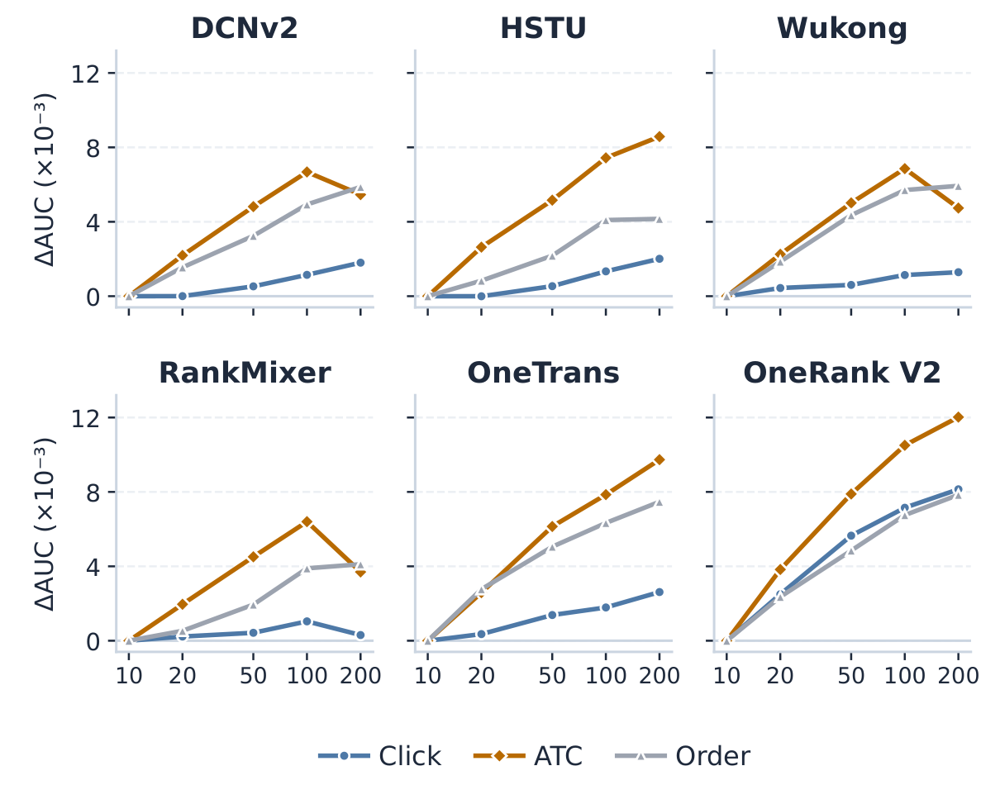

# 🔥 RecAgora 🔥

**RecAgora: Toward Production-Aligned Benchmarking of Modern Ranking Models**

RecAgora is an e-commerce search ranking benchmark built around production candidate sets, rich features, and industrial-scale data. It combines two request-level datasets with a shared feature-processing pipeline and distributed training and evaluation for **23 ranking models and implementation variants**.

[Dataset on Hugging Face](https://huggingface.co/datasets/PIIR/RecAgora) · [Documentation](docs/README.md) · [Models](docs/rank-model-list.md) · [Data](docs/dataset/README.md) · [Reproduction protocol](docs/guides/train-and-evaluate.md#paper-reproduction) · [Paper results](docs/guides/metrics.md#paper-results) · [Python API](docs/public-api.md)



*Figure 1. Request structure, dataset construction, and the unified ranking benchmark.*

<a id="benchmark-at-a-glance"></a>

## 📊 Benchmark at a glance

- **Production candidate groups:** 24 candidates per request, including exposed and unexposed candidates with source tags. Click, add-to-cart, and order targets are aligned by candidate position.
- **Rich production signals:** 160 fields covering queries, items, query–item interactions, user–item relationships, and histories of up to 200 events.
- **Shared infrastructure:** request-level model inputs, semantic embedding sharing, aligned history processing, TorchRec sparse-embedding sharding, and exact global AUC evaluation.

| Manuscript dataset | CLI profile | Training requests | Evaluation requests | Temporal split |
| --- | --- | ---: | ---: | --- |
| RecAgora-60M | `small` | 52,901,479 | 7,288,725 | DAY01–DAY07 / DAY08 |
| RecAgora-270M | `large` | 261,792,919 | 7,485,173 | DAY01–DAY34 / DAY35 |

Counts are reported in manuscript Table 2, not measured on the bundled Toy sample. The two profiles have separate vocabularies and time windows. See the [data documentation](docs/dataset/README.md) for schema, source semantics, and release scope.



*Figure 2. Candidate sources and data distributions. Panels (b)–(d) use the training splits; behavior counts are in millions.*

<a id="quick-start"></a>

## 🚀 Quick Start

Run from the repository root after obtaining this checkout. The following is a pipeline smoke test, not a reproduction of the full benchmark.

### Install

Use Linux and a CUDA-capable NVIDIA GPU. The dependency file targets PyTorch 2.8.0, TorchRec 1.3.0, and FBGEMM-GPU 1.3.0; its CUDA requirement is 12.6+. A Python 3.12 environment is recommended. GPU and host-memory requirements depend strongly on the sparse vocabulary and model; a small request sample still uses the configured full embedding tables.

```bash
python3.12 -m venv .venv
source .venv/bin/activate
python -m pip install --upgrade pip
python -m pip install -r requirements.txt
python -m pip check
```

Use mutually compatible PyTorch, TorchRec, FBGEMM, CUDA, and driver builds. The release-tested hardware/software matrix is pending.

### Train and evaluate the Toy sample

The sample contains 1,454 requests in DAY01 and 1,391 in DAY02. `run.sh` uses the active Python environment and runs training followed by evaluation by default.

```bash
export OUTPUT_BASE="$PWD/results/toy"
export WORLD_SIZE=1 RANK=0 MASTER_ADDR=127.0.0.1 MASTER_PORT=29500
bash run.sh \
  --dataset small --exp onetrans_toy \
  --config configs/models/onetrans/onetrans.yaml \
  --data-root ./datasets/toy-small-public \
  --train-days 01-01 --eval-days 02-02 --batch 512

python -m json.tool results/toy/onetrans/onetrans_toy/outputs/eval_metrics.json
```

Training uses DAY01 and evaluation uses DAY02. The default data contract does not read top-level `user_id` or `item_id`; candidate identity features inside slots remain present. Toy metrics must not be compared with manuscript Table 3.

## Run the benchmark

After obtaining the full data, organize Small/Large as `dt=DAYxx/*.parquet`. Set the distributed environment above for a one-process job, or use your launcher's per-node environment and run the same command on each node. The shell launcher starts one GPU process per node; its `WORLD_SIZE` and `RANK` specify node count and node rank. Select the process count and per-process request batch from [the paper protocol](docs/guides/train-and-evaluate.md#paper-reproduction), rather than using the one-process smoke-test setup for reported results.

```bash
# Standard full-candidate run; data path is supplied by the user.
bash run.sh --dataset large --exp rankmixer_large \
  --config configs/models/rankmixer/rankmixer.yaml \
  --data-root /path/to/recagora-270m --batch 512
```

| Setting | Configuration / selection |
| --- | --- |
| Full scope (main results) | `<model>.yaml`; all 24 candidates |
| Exposed-only scope | `<model>_negmask.yaml`; identical masking in training and evaluation |
| Active-user analysis | `--dataset hotuser`; Large users active on at least 20 of 34 days, using the Large vocabulary; only `train/` and `valid/` splits |
| OneRank V2 | Separate pretraining and ranking configurations; [stage and manuscript notes](docs/guides/train-and-evaluate.md#paper-reproduction) |

Unexposed candidates have zero labels because their feedback was not observed; zero is not evidence of negative user preference. Full-scope and exposed-only metrics describe different candidate populations and should not be directly compared as if they shared an evaluation set.

## Findings reported in the manuscript

- Cross-scale model AUC rankings have Spearman correlations of **0.96 / 0.97 / 0.94** for click / add-to-cart / order.
- OneRank V1 and V2 occupy the top two AUC positions on all three tasks in both data versions.
- Restricting the candidate scope to exposed items changes **20 of 23** models' ranks on at least one task.
- User activity and history length affect model comparisons; longer histories generally help, with model-dependent gains.



*Figure 3. AUC gains on RecAgora-60M relative to each model's length-10 baseline. The history-length axis is logarithmic.*

These summarize manuscript Sections 4.3–4.4. [Reported scores](docs/guides/metrics.md#paper-results) are manuscript reference values, not a fresh evaluation of this checkout. Small differences are not presented as statistically significant; the manuscript reports a fixed-seed protocol.

## Extend RecAgora

```python
from recagora import RecAgoraRankingModel, RecAgoraInputSpec, RecAgoraSparseBatch
from training import RecAgoraConfig, load_recagora_config
```

See [adding a model](docs/guides/add-a-model.md), the [OneTrans-Lite demo](scripts/recagora_demo/onetrans_lite/README.md), and the [public API](docs/public-api.md). Architecture-specific adaptations are benchmark implementations, not claims of bit-for-bit equivalence with upstream industrial systems.

<a id="citation"></a>

## 📝 Citation

If you use RecAgora in your research, please cite the following work. Fields marked `TODO` are placeholders and will be updated when publication details are available.

```bibtex
@misc{recagora,
  title = {{RecAgora}: Toward Production-Aligned Benchmarking of Modern Ranking Models},
  author = {Zhanshuo Cao and Ke Guo and Lehua He and Yuxuan Zhu and Bingjun Chen and Cong Fu and Kangle Wu and Yabo Ni and Guanxing Zhang and Sunhao Dai and Jun Xu},
  year = {2026},
  howpublished = {TODO},
  url = {TODO}
}
```
